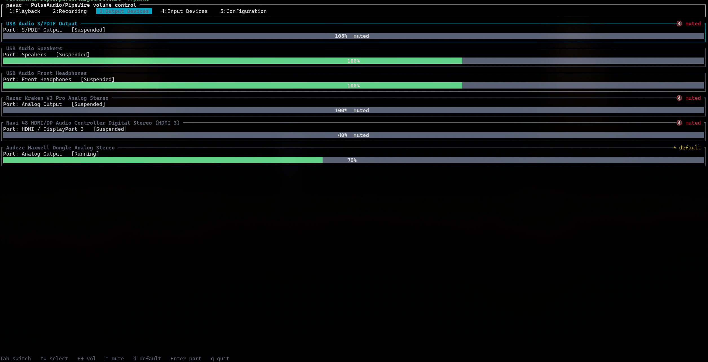

# pavuc

A **[pavucontrol](https://freedesktop.org/software/pulseaudio/pavucontrol/) analogue** TUI built with [ratatui](https://ratatui.rs).



## Features

A faithful, keyboard-driven port of pavucontrol's functionality:

- **Playback** — per-application streams with volume bars, mute, routing to a
  different output (`Enter`), and the ability to kill a stream (`x`).
- **Recording** — per-application capture streams with volume, mute and routing
  to a different input, including monitor sources (to record what is playing).
- **Output Devices** — sinks with volume, mute, set-as-default (`d`) and port
  selection (`Enter`).
- **Input Devices** — sources with volume, mute, set-as-default and port
  selection.
- **Configuration** — sound cards with profile selection (`Enter`).
- Live updates: the view reflects changes made by other apps in real time via
  PulseAudio's subscription events.
- Volume changes keep the balance between channels, as pavucontrol does; the
  shown level is the loudest channel.
- Reconnects on its own when the audio server restarts.
- Commands the server refuses (e.g. an unavailable profile) are reported in
  the status line.

## Requirements

- A running **PulseAudio** server **or PipeWire with `pipewire-pulse`**.
- `libpulse` at build time.

## Installation

```sh
cargo install pavuc
```

or from a checkout: `cargo build --release` (the binary is
`target/release/pavuc`).

## Usage

```text
pavuc [OPTIONS]

  -c, --config <FILE>       Path to a TOML configuration file
  -l, --log-level <LEVEL>   Log level (error, warn, info, debug, trace)
      --log-file <FILE>     Append logs to this file instead of stderr
      --client-name <NAME>  Application name reported to the audio server
      --tick-ms <MS>        Event-loop tick interval in milliseconds (10-1000)
```

Like other PulseAudio clients, pavuc honours `PULSE_SERVER` to reach a
server other than the default.

## Configuration

pavuc reads `$XDG_CONFIG_HOME/pavuc/config.toml` (or
`~/.config/pavuc/config.toml`) when it exists, or the file given with
`--config`. Command-line flags override the file. Every key is optional and
unknown keys are rejected; see [`examples/pavuc.toml`](examples/pavuc.toml):

| Key           | Default | Meaning                                                 |
| ------------- | ------- | ------------------------------------------------------- |
| `client_name` | `pavuc` | Application name reported to the audio server           |
| `log_level`   | `warn`  | `error`, `warn`, `info`, `debug` or `trace`             |
| `log_file`    | none    | Append logs to this file (created readable by you only) |
| `tick_ms`     | `100`   | How often the UI checks for server changes, 10-1000 ms  |

Without `log_file`, logs go to stderr but are dropped while the TUI is on
screen, since they would draw over it.

## Keybindings

| Key                          | Action                                              |
| ---------------------------- | --------------------------------------------------- |
| `1`–`5`, `Tab` / `Shift+Tab` | Switch tabs                                         |
| `↑`/`↓` or `k`/`j`           | Move selection                                      |
| `←`/`→` or `h`/`l`           | Volume −/+ 5%                                       |
| `<`/`>` or `,`/`.`           | Volume −/+ 1% (fine)                                |
| `m`                          | Toggle mute                                         |
| `d`                          | Set device as default (Output/Input tabs)           |
| `Enter`                      | Route stream / select port / select profile (popup) |
| `x`                          | Kill the selected stream (Playback/Recording)       |
| `q` / `Esc`                  | Quit (or close an open popup)                       |
| `Ctrl+C`                     | Quit                                                |
